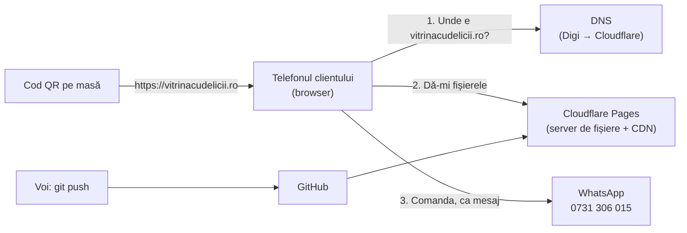
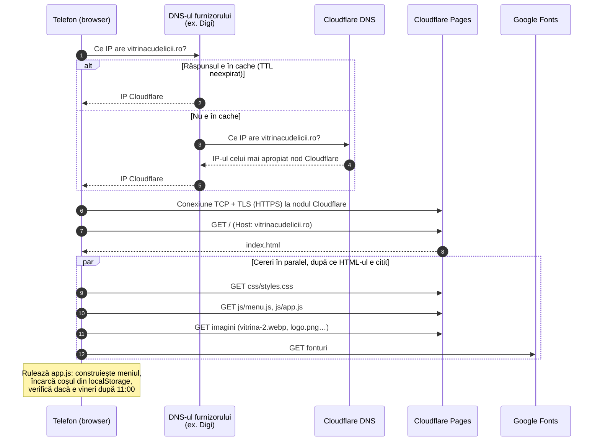
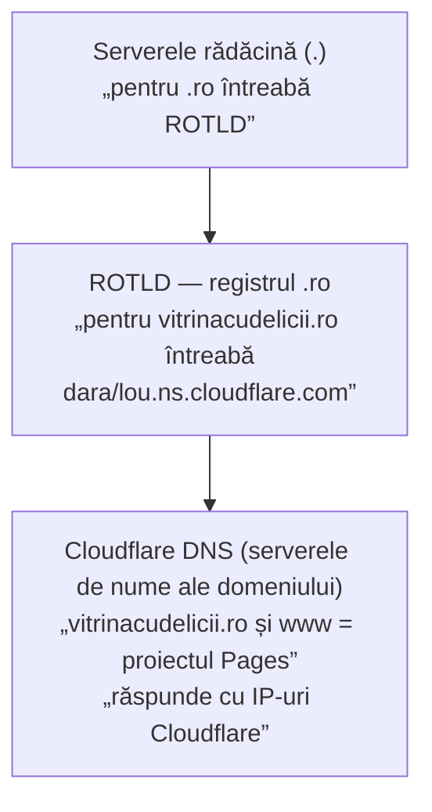
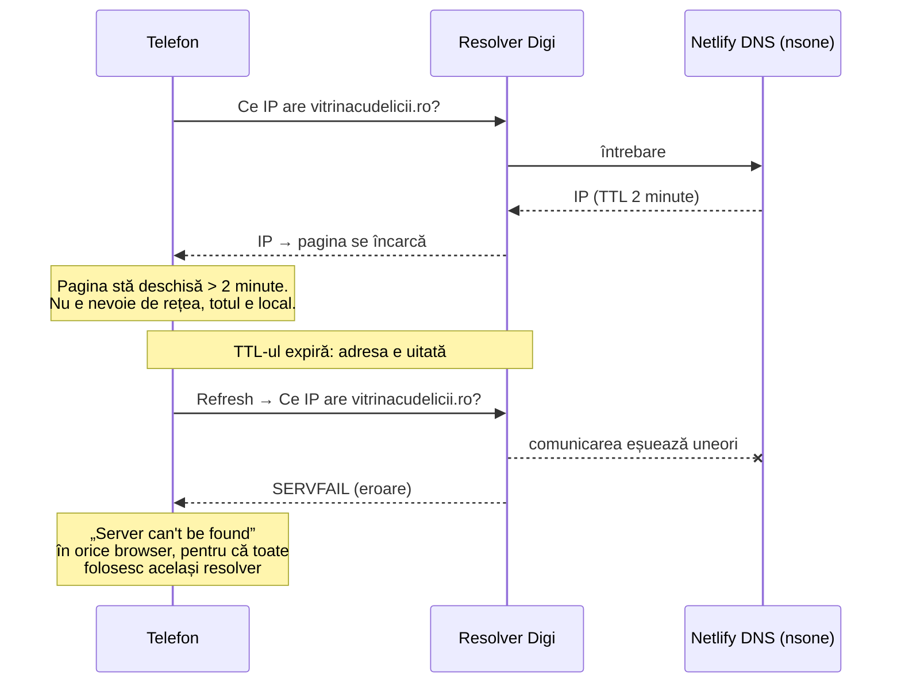
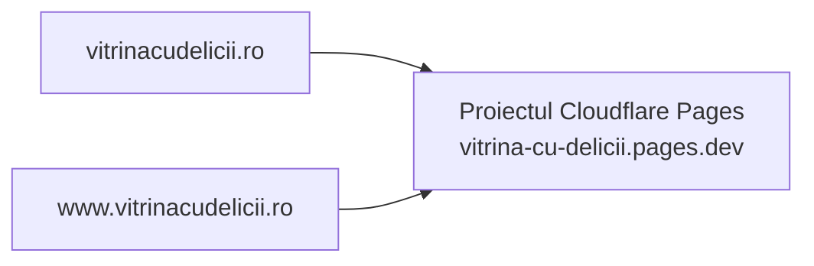
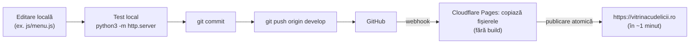
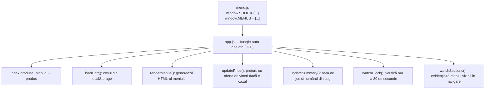
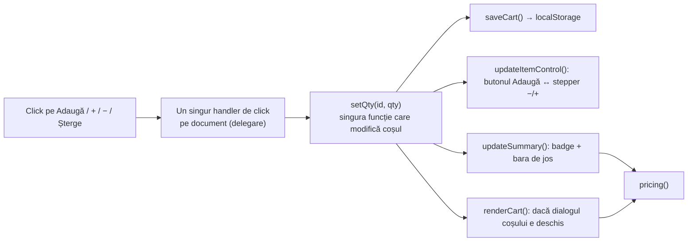
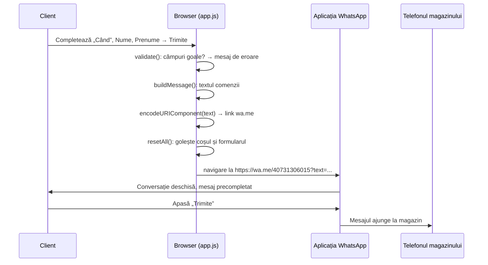

# Cum funcționează site-ul Vitrina cu Delicii

Documentație tehnică pentru cine vine din C++ / CMake și nu din web. Explică ce se întâmplă de la scanarea codului QR până la mesajul de WhatsApp, ce rol au DNS-ul, Cloudflare (DNS și găzduire) și furnizorul de internet, și unde se modifică fiecare lucru.

Diagramele sunt scrise în [Mermaid](https://mermaid.js.org/). Pe GitHub apar direct ca desene. În VS Code aveți nevoie de extensia „Markdown Preview Mermaid Support”.

---

## 1. Pe scurt

Site-ul e un **site static**: un set de fișiere (HTML, CSS, JavaScript, imagini) pe care un server le trimite exact așa cum sunt. Nu există server de aplicație, bază de date, conturi sau plăți. Toată logica (meniul, coșul, prețurile, oferta de vineri) rulează **în browserul clientului**. Comanda pleacă ca **mesaj WhatsApp precompletat** de pe telefonul clientului.



### Analogia cu C++

| Web (acest proiect) | Echivalent aproximativ în C++ |
|---|---|
| `index.html` | Layout-ul UI-ului, ca un fișier `.ui` din Qt: structura ferestrei, fără logică |
| `css/styles.css` | Stylesheet-ul (QSS în Qt): culori, fonturi, dimensiuni, layout |
| `js/menu.js` | Un header cu date constante (`constexpr`), un fel de fișier de configurare |
| `js/app.js` | `main()` plus toată logica aplicației |
| Browserul | Runtime-ul și framework-ul de UI: parsează, randează, rulează JS, livrează evenimente |
| DOM | Arborele de widget-uri, construit din HTML și modificat din JS |
| Cloudflare Pages | Serverul de distribuție: „instalarea” se face la fiecare deschidere de pagină |
| `git push` → Cloudflare Pages | Pipeline-ul de CI/CD; aici nu există pas de build, fișierele se publică așa cum sunt |

Nu există compilare, linker sau `cmake --build`. Browserul primește sursa și o interpretează. Echivalentul unui „build” e doar copierea fișierelor pe server.

---

## 2. Tehnologii folosite

| Tehnologie | Ce face aici | Note |
|---|---|---|
| **HTML** | Structura paginii: header, secțiuni goale pentru meniu, dialogul coșului, formularul | Majoritatea conținutului e generat din JS în containere marcate cu `data-*` |
| **CSS** | Aspectul: culorile din fațadă, fonturile, banda cu romburi, adaptarea la telefon și desktop | Variabile CSS (`--walnut`, `--rose`…) pe `:root`, ca niște constante globale |
| **JavaScript (ES2017+)** | Meniul, coșul, prețurile, oferta de vineri, mesajul WhatsApp | Scripturi „clasice”, fără module, fără framework (fără React/Vue), fără dependențe |
| **localStorage** | Ține minte coșul dacă clientul închide pagina | Stocare cheie-valoare în browser, pe dispozitivul clientului |
| **Google Fonts** | Fonturile Bodoni Moda (titluri) și Alegreya Sans (text) | Încărcate de pe serverele Google |
| **qrcodejs 1.0.0** | Generează codul QR pe pagina `qr.html` | Bibliotecă JS încărcată de pe cdnjs |
| **wa.me** | Link oficial WhatsApp care deschide o conversație cu text precompletat | `https://wa.me/40731306015?text=...` |
| **Git + GitHub** | Versionarea codului | Ramura `develop` e cea publicată |
| **Cloudflare Pages** | Găzduiește fișierele, emite certificatul HTTPS, le distribuie prin CDN | Plan gratuit: trafic nelimitat, 500 de publicări pe lună |
| **Cloudflare DNS** | Răspunde la întrebarea „ce adresă IP are vitrinacudelicii.ro?” | Plan gratuit, în același cont cu găzduirea |
| **ROTLD + registrar** | ROTLD administrează `.ro`. Registrarul e firma de la care s-a cumpărat domeniul | Acolo se setează serverele de nume (Cloudflare) |

---

## 3. Fișierele proiectului

```text
vitrina_cu_delicii_app/
├── index.html              Pagina principală: schelet, cartonașe de oferte, coș, formular
├── qr.html                 Pagina care generează cartonașul cu cod QR, de tipărit (adresa publică: /qr)
├── 404.html                Pagina pentru adrese inexistente
├── js/
│   ├── menu.js             DATELE: produse, prețuri, program, telefon, oferte (singurul fișier de editat pentru conținut)
│   └── app.js              LOGICA: randează meniul, coș, prețuri, oferta de vineri, WhatsApp
├── css/
│   └── styles.css          ASPECTUL: culori, fonturi, layout pentru telefon și desktop
├── assets/img/             Imagini optimizate pentru web (.webp + .jpg), logo, favicon, og-image
├── vitrina_cu_delicii_photos/  Fotografiile originale (sursa pentru imaginile din assets)
├── favicon.ico, apple-touch-icon*.png
│                           Iconițe la rădăcină: browserele și aplicațiile le cer automat aici, chiar dacă pagina indică alte fișiere
├── robots.txt, sitemap.xml Instrucțiuni pentru motoarele de căutare: ce să indexeze și ce nu
├── docs/                   Documentația (acest fișier)
├── CLAUDE.md               Instrucțiuni pentru asistentul AI care lucrează pe proiect
└── README.md
```

Ordinea în care browserul le încarcă e dată de `index.html`: întâi CSS-ul (în `<head>`), apoi la final `js/menu.js` și `js/app.js`. Ordinea contează: `menu.js` definește datele, iar `app.js` le folosește. E ca ordinea de includere a header-elor.

---

## 4. Ce se întâmplă când un client scanează codul QR

Codul QR conține doar textul `https://vitrinacudelicii.ro/`. Telefonul îl deschide în browser, iar de acolo urmează pașii de mai jos.



**Pașii 1–3 (DNS):** telefonul nu știe unde e `vitrinacudelicii.ro`. Știe doar să întrebe serverul DNS primit de la rețea, adică al Digi pe Wi-Fi-ul de acasă sau pe date mobile Digi. Detalii în secțiunea 5.

**Pașii 4–5 (HTTPS):** cu adresa IP, telefonul deschide o conexiune criptată (TLS) cu cel mai apropiat nod Cloudflare (există și în România) și cere pagina. Antetul `Host: vitrinacudelicii.ro` îi spune lui Cloudflare ce site vrem. Aceeași adresă IP servește mii de site-uri.

**Pașii 6–10:** HTML-ul conține referințe la alte fișiere, iar browserul le cere în paralel. Toată pagina are câteva sute de KB, majoritatea imagini.

**După încărcare**, site-ul nu mai vorbește cu niciun server. Adăugarea în coș, calculul prețurilor și construirea mesajului se fac local, în browser. Rețeaua mai e folosită doar când clientul apasă „Trimite comanda pe WhatsApp”.

---

## 5. DNS: cum se găsește site-ul

### 5.1 Ce e DNS

DNS e „agenda telefonică” a internetului: transformă un nume (`vitrinacudelicii.ro`) într-o adresă IP, de exemplu `104.21.x.x`. E un sistem ierarhic și distribuit. Nimeni nu are lista completă. Fiecare nivel știe doar cine răspunde la nivelul următor.



Rolurile, pe scurt:

| Cine | Rol | Ce am configurat acolo |
|---|---|---|
| **Registrarul** (firma de la care s-a cumpărat domeniul) | Vă vinde domeniul și transmite setările la ROTLD | Serverele de nume: `dara.ns.cloudflare.com`, `lou.ns.cloudflare.com` |
| **ROTLD** | Registrul oficial pentru toate domeniile `.ro` | Nimic direct. Preia serverele de nume de la registrar |
| **Cloudflare DNS** | „Server de nume autoritativ”: are ultimul cuvânt despre domeniu | `vitrinacudelicii.ro` și `www` → proiectul Pages `vitrina-cu-delicii.pages.dev`, cu proxy (nor portocaliu), create automat la „Custom domains” |
| **DNS-ul furnizorului** (Digi, Orange, Google 8.8.8.8…) | „Resolver recursiv”: face drumul de mai sus în numele telefonului și ține minte răspunsul | Nimic. Nu e al nostru |
| **Cloudflare Pages** | Serverul care livrează fișierele | Proiectul `vitrina-cu-delicii`, legat de GitHub, ramura `develop`, cu domeniile `vitrinacudelicii.ro` și `www` |

### 5.2 Cache și TTL

Fiecare răspuns DNS vine cu un **TTL** (time to live): cât timp poate fi ținut minte. E ca un cache cu expirare.

- Telefonul și resolver-ul Digi țin minte adresa până expiră TTL-ul.
- Cât timp e în cache, nu se mai întreabă nimeni, iar răspunsul vine instant.
- După expirare, întrebarea se reface pe tot drumul.

### 5.3 Ce s-a întâmplat cu Digi (studiu de caz)

Inițial, DNS-ul domeniului era la **Netlify DNS**, cu un TTL de **2 minute**. Simptomul: dacă pagina stătea deschisă un timp și dădeați refresh, uneori apărea „Safari can't find the server”, chiar și în Chrome și chiar pe date mobile.



Ce am verificat atunci:

- Serverele Netlify DNS răspundeau corect când erau întrebate direct.
- Registrul `.ro` avea configurarea corectă.
- Google (8.8.8.8), Cloudflare (1.1.1.1) și Quad9 răspundeau corect de fiecare dată.
- Doar resolver-ul Digi dădea uneori `SERVFAIL` pentru acest domeniu.

Concluzia: o problemă intermitentă între resolver-ele Digi și serverele de nume ale Netlify, amplificată de TTL-ul de 2 minute. Cu un TTL scurt, aproape fiecare revenire în pagină declanșa o întrebare nouă către Digi, deci o nouă șansă de eroare.

Soluția a fost mutarea DNS-ului la **Cloudflare**: servere foarte răspândite, cu noduri în România, cu care Digi comunică bine. După mutare, testul care dădea erori a mers de 30 de ori din 30. TTL-ul a fost întâi de o oră. De când site-ul e găzduit chiar pe Cloudflare (înregistrări cu proxy, secțiunea 5.4), Cloudflare îl fixează la 5 minute, ceea ce nu mai e o problemă, pentru că întrebările ajung la servere care răspund corect.

### 5.4 Norul portocaliu (proxy) în Cloudflare

Fiecare înregistrare din Cloudflare DNS are un nor: **gri** („DNS only”, Cloudflare doar spune unde e serverul) sau **portocaliu** („Proxied”, traficul trece prin serverele Cloudflare). Pentru Cloudflare Pages norul e **portocaliu**, iar asta e obligatoriu: Cloudflare nu mai e doar agenda telefonică, ci chiar gazda. Răspunde la DNS cu IP-urile propriilor noduri, apoi servește fișierele de acolo.

Cât timp site-ul era la Netlify, norul era gri, ca traficul să meargă direct la Netlify. Două rețele CDN suprapuse ar fi încurcat certificatul HTTPS și cache-ul.

### 5.5 `vitrinacudelicii.ro` vs `www` vs `.pages.dev`



- Ambele nume duc la același proiect. Cloudflare le-a creat singur ca înregistrări `CNAME` spre `vitrina-cu-delicii.pages.dev`, la adăugarea domeniilor în proiect.
- **CNAME:** numele e un alias al altui nume („uită-te acolo”). În bara de adrese nu se schimbă nimic.
- Pe domeniul principal (apex), standardul DNS nu permite CNAME. Cloudflare îl „aplatizează” (CNAME flattening) și răspunde direct cu adresele IP.
- `vitrina-cu-delicii.pages.dev` e adresa internă a proiectului. Merge și ea, dar nu se pune pe QR sau pe afișe.

---

## 6. HTTPS și CDN

- **HTTPS** = HTTP criptat prin TLS. Browserul verifică un **certificat** care dovedește că serverul chiar e `vitrinacudelicii.ro`.
- Cloudflare emite și reînnoiește automat certificatul pentru `vitrinacudelicii.ro` și `www`.
- Cererile pe `http://` sunt redirecționate automat pe `https://`.
- Fișierele stau pe **CDN-ul** Cloudflare (rețea de servere în multe țări, inclusiv România). Clientul din Oravița le primește de la cel mai apropiat nod.

### 6.1 De ce Cloudflare Pages și nu Netlify

Site-ul a fost găzduit la început pe Netlify. Pe 14 octombrie 2026 am mutat găzduirea pe Cloudflare Pages, din două motive:

- **Creditele Netlify.** Planul gratuit Netlify are 300 de credite pe lună. Fiecare publicare costă 15 credite, iar traficul consumă și el (20 de credite pe GB). Cu publicări după fiecare mică modificare, creditele s-au terminat în două zile, iar publicările s-au blocat. Dacă se terminau și creditele pentru trafic, Netlify oprea site-ul.
- **Badge-ul „Powered by Netlify”.** Pe planul gratuit, Netlify adăuga în pagină un script care afișa badge-ul în colțul din dreapta jos. Nu era în codul nostru.

Cloudflare Pages are, pe planul gratuit, trafic nelimitat și 500 de publicări pe lună, și nu adaugă nimic în pagină.

---

## 7. Cum se publică o modificare (deploy)



- Cloudflare Pages urmărește ramura **`develop`** din GitHub. Fiecare push pe `develop` publică automat o versiune nouă. Ramura `main` nu se folosește.
- Publicarea e **atomică**: noua versiune înlocuiește dintr-odată versiunea veche, fără stări intermediare. În Cloudflare → Workers & Pages → proiectul `vitrina-cu-delicii` → Deployments se poate reveni la orice versiune anterioară cu un click („Rollback”), ca un `git revert` instant.
- Nu există pas de build. Ca idee, comparat cu CMake: e ca un proiect header-only, fără configurare și compilare, doar cu copierea fișierelor.

**Test local, înainte de push:**

```bash
python3 -m http.server 8765
# apoi în browser: http://localhost:8765/
```

Comanda pornește un server web minimal care servește folderul curent, la fel cum îl servește Cloudflare Pages. Pe telefon, din aceeași rețea Wi-Fi, se poate deschide `http://IP-ul-Mac-ului:8765/`.

---

## 8. În browser: cum e construită aplicația

### 8.1 Pornirea

Browserul citește `index.html` de sus în jos și construiește **DOM-ul**, arborele de elemente. Mare parte din pagină e scrisă direct în HTML: header, poza, cartonașele, programul, formularul. Meniul însă e doar un container gol:

```html
<div id="meniu" class="menus" data-menus></div>
```

La final se rulează scripturile:



- `window.SHOP` și `window.MENUS` sunt **variabile globale**. Scripturile clasice partajează un singur spațiu global, ca simbolurile externe dintr-un program C.
- `app.js` e învelit într-o funcție care se apelează imediat (`(function () { ... })();`). Variabilele lui rămân private, similar cu un `namespace` anonim din C++.

### 8.2 Starea și fluxul de date

Starea aplicației e mică: un singur `Map` cu coșul (id produs → cantitate) și un `bool` pentru oferta de vineri.



- **Delegare de evenimente:** în loc de câte un handler pe fiecare buton, există unul singur pe tot documentul. Acesta verifică pe ce s-a apăsat (`data-add`, `data-inc`, `data-dec`, `data-remove`). E ca un singur `switch` pe tipul mesajului într-o buclă de evenimente.
- **`setQty()` e singurul punct de mutație.** Orice schimbare a coșului trece pe aici și actualizează toate vizualizările. Un fel de model-view simplu, fără framework.
- **`pricing()` e o funcție pură.** Din coș și din ora curentă calculează liniile, reducerile și totalul. Meniul, coșul, bara de jos și mesajul WhatsApp folosesc toate aceeași funcție, deci nu pot da sume diferite.

### 8.3 Oferta de vineri

- Activă **vinerea de la 11:00, ora României**, folosind fusul `Europe/Bucharest`, nu ora telefonului. Un telefon setat pe alt fus orar vede tot ora României.
- Se aplică doar la **Patiserie**. Fast-food-ul și băuturile au `offers: false` în `menu.js`.
- Prețul pe bucată se înjumătățește și se rotunjește la 50 de bani (5,50 → 3).
- Un timer verifică ora la fiecare 30 de secunde. Dacă pagina e deschisă exact când trece 11:00, prețurile se schimbă singure.
- Decide **ora trimiterii comenzii**. Personalul vede oricum prețurile în mesaj înainte să confirme.

### 8.4 Trimiterea comenzii



- **Comanda nu trece prin niciun server al nostru.** Site-ul doar construiește un link. Comanda există numai ca mesaj WhatsApp, trimis de client din contul lui.
- `encodeURIComponent` transformă textul (diacritice, `×`, `–`, rânduri noi) într-o formă sigură pentru URL, de exemplu `ă` → `%C4%83`.
- Pe telefon, link-ul se deschide în aceeași filă, care pornește aplicația WhatsApp. Varianta asta merge și în browserele din Facebook și Instagram. Pe desktop se deschide o filă nouă cu WhatsApp Web.
- Înainte de navigare, coșul se golește. Dacă clientul revine cu „Înapoi”, găsește pagina curată și nu poate retrimite din greșeală aceeași comandă.
- Nu se păstrează nimic despre client: numele nu se salvează nicăieri.

Formatul mesajului e cerut de proprietar și trebuie păstrat exact:

```text
Comandă nouă:
2× Covrig cu sare – 6 lei
1× Burger de vită – 30 lei
Total: 36 lei
Ridicare: pauza mare
Nume: Popescu
Prenume: Andrei
```

---

## 9. Compatibilitate cu telefoane vechi

Site-ul trebuie să meargă pe orice telefon, inclusiv iPhone-uri vechi și browserele din aplicațiile Facebook și Instagram. Câteva măsuri:

| Problemă | Soluție în cod |
|---|---|
| `<dialog>` (fereastra coșului) nu există înainte de iOS 15.4 | `app.js` detectează lipsa lui și simulează dialogul cu un atribut, o clasă CSS și un fundal propriu |
| `replaceChildren()` lipsește pe browsere vechi | Polyfill la începutul `app.js`: o implementare proprie, adăugată doar dacă lipsește |
| Formatarea numerelor diferă după limba browserului | Prețurile se formatează manual (`num()`), cu virgulă: „6,50”, „11,99” |
| Ferestre noi blocate în browserele din aplicații | Pe telefon, WhatsApp se deschide în aceeași filă |
| Fără JavaScript | Adresa, telefonul și programul sunt scrise direct în HTML și se văd oricum |

Un **polyfill** e echivalentul unui `#ifndef HAVE_X` urmat de o implementare proprie: codul verifică la rulare dacă funcția există și o adaugă doar când lipsește.

---

## 10. Previzualizări la distribuire și Google

În `<head>`-ul din `index.html` sunt câteva informații pe care nu le vede clientul, ci alte programe:

- **Open Graph** (`og:title`, `og:image`…): titlul și poza din previzualizarea linkului pe WhatsApp și Facebook. Adresa imaginii trebuie să fie completă (`https://...`), pentru că roboții Facebook nu completează căile relative.
- **JSON-LD** (`<script type="application/ld+json">`): date structurate pentru Google (tip `Bakery`, adresă, telefon, program), ca să poată fi afișate direct în rezultate.

Dacă programul sau telefonul se schimbă, trebuie actualizate în `js/menu.js` **și** în `index.html`: în textul vizibil și în blocul JSON-LD.

---

## 11. Unde modific ce

| Vreau să… | Fișier | Ce fac |
|---|---|---|
| Schimb un preț, un nume sau o descriere | `js/menu.js` | Editez produsul. **Nu schimb `id`-ul**, altfel produsul dispare din coșurile salvate |
| Adaug un produs | `js/menu.js` | Copiez un rând existent și îi dau un `id` nou, unic |
| Schimb alergenii unui produs | `js/menu.js` | Lista `allergens: ["gluten", "ouă", …]` a produsului |
| Marchez un produs ca fiind (sau nu) din produs congelat | `js/menu.js` | Adaug sau șterg `frozen: true` |
| Schimb programul sau telefonul | `js/menu.js` **și** `index.html` | Textul vizibil și blocul JSON-LD din `<head>` |
| Opresc sau pornesc oferta de vineri | `js/menu.js` | `offers: { fridayHalfPrice: false }` |
| Scot un meniu întreg din ofertă | `js/menu.js` | `offers: false` la nivelul meniului |
| Schimb textul cartonașelor | `index.html` | Secțiunea `offers` |
| Schimb culori sau fonturi | `css/styles.css` | Variabilele din `:root` |
| Generez un cod QR nou | — | Deschid `https://vitrinacudelicii.ro/qr.html` → Generează → Tipărește |

După orice modificare: test local, apoi `git push origin develop`. Cloudflare Pages publică automat.

---

## 12. Glosar

| Termen | Explicație |
|---|---|
| **Site static** | Fișiere servite exact cum sunt, fără cod care rulează pe server |
| **DOM** | Arborele de elemente al paginii, construit din HTML și modificat din JS |
| **CDN** | Rețea de servere care țin copii ale fișierelor aproape de utilizatori |
| **DNS** | Sistemul care transformă nume de domenii în adrese IP |
| **Resolver** | Serverul DNS al furnizorului de internet, care caută răspunsul în numele vostru |
| **Server de nume (autoritativ)** | Serverul care deține răspunsul oficial pentru un domeniu (aici Cloudflare) |
| **TTL** | Cât timp poate fi ținut minte un răspuns DNS |
| **A record / CNAME** | Nume → adresă IP / nume → alt nume |
| **TLS / HTTPS** | Criptarea conexiunii și verificarea identității serverului prin certificat |
| **Redirect 301** | Răspuns HTTP de tipul „resursa s-a mutat definitiv la altă adresă” |
| **localStorage** | Stocare cheie-valoare în browser, pe dispozitivul clientului |
| **Polyfill** | Implementare proprie a unei funcții care lipsește din browserele vechi |
| **IIFE** | Funcție apelată imediat după definire, folosită pentru a izola variabilele |
| **Delegare de evenimente** | Un singur handler pe un părinte care tratează click-urile tuturor copiilor |
| **Open Graph** | Metadate pentru previzualizarea linkurilor în rețelele sociale |
| **SERVFAIL** | Răspuns DNS „resolver-ul nu a reușit să afle răspunsul” (eroare de server, nu „nu există”) |
